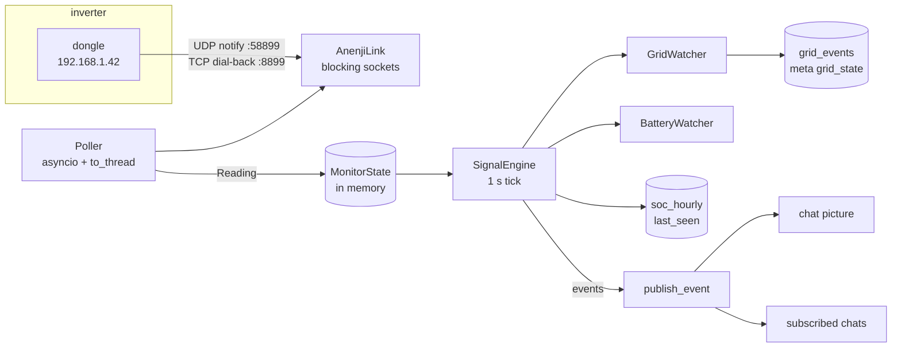

# Architecture

## Module map

| module | responsibility |
|---|---|
| `main.py` | wiring: config, link, poller, engine, bot, routers, startup report, tasks |
| `anenji_monitor/config.py` | TOML config → frozen dataclasses |
| `anenji_monitor/modbus.py` | dongle transport: UDP notify, TCP accept, RTU framing, CRC, redial/backoff |
| `anenji_monitor/registers.py` | `registers.toml` → `RegisterMap` (scaling, labels, batching) |
| `anenji_monitor/poller.py` | polling loop, batched reads, `Reading`/`MonitorState` snapshot |
| `anenji_monitor/events.py` | `GridWatcher`, `BatteryWatcher`, `SignalEngine`, `stream()` |
| `anenji_monitor/battery.py` | voltage → SOC curve and `SocEstimator` |
| `anenji_monitor/recovery.py` | startup classification (first start / restart / long gap / drained) |
| `anenji_monitor/store.py` | SQLite: chats, grid history, SOC rollup, meta |
| `anenji_monitor/text.py` | Ukrainian copy: durations, event/battery/recovery messages |
| `anenji_monitor/render.py` | device status, `/all`, `/regs`, `/raw` rendering |
| `anenji_monitor/stats.py` | `/stats` windows, uptime math, rendering |
| `anenji_monitor/bot.py` | aiogram routers, roles, settings UI, publishing |
| `anenji_monitor/alerts.py` | inverter-offline watchdog for admins |
| `anenji_monitor/simulator.py` | fake dongle for offline work and tests |
| `tools/import_dessmonitor.py` | backfill history from a cloud `.xlsx` export |

## Data flow

## Concurrency model

- One asyncio loop owns Telegram and every database call.
- Modbus I/O is blocking and runs inside `asyncio.to_thread`; `AnenjiLink` guards the
  socket with a `threading.Lock`, so `/raw` can never interleave with a poll cycle.
- Background tasks: `poller`, `events` (stream + signal evaluation), `alerts`
  (offline watchdog), `photo-guard` (30 min repair), plus aiogram polling.
- Shutdown closes the link first so a thread stuck in `accept()` returns, then cancels
  the tasks and closes the store.

## Storage schema (`state.db`)

| table | columns | meaning |
|---|---|---|
| `chats` | `chat_id` PK, `title`, `grid_lost`, `grid_restored`, `sync_photo`, `battery`, `photo_powered`, `added_by`, `added_at` | subscriptions and per-chat toggles; `photo_powered` = which state the chat picture shows |
| `grid_events` | `ts`, `powered` (unique `ts`) | one row per state change, the history `/stats` is computed from |
| `soc_hourly` | `hour` PK, `min_soc`, `max_soc`, `sum_soc`, `count` | hourly SOC rollup, written on every poll |
| `meta` | `key` PK, `value` | `grid_powered`, `grid_since`, `last_seen` |

`state.db` is user data: it carries subscriptions, the current grid anchor, history and
statistics. Never delete it to "reset" code.

## Invariants

1. **One owner per dongle.** The dongle accepts a single TCP session; two pollers make
   both fail. Two pollers also fight over the Telegram long-poll (409).
2. **`grid_events` holds transitions only.** Repeating the same state inflates outage
   counts, so `Store.set_grid_state` and `compact_grid_events` enforce it.
3. **The current state anchor survives restarts** while the state is unchanged —
   otherwise every restart resets "no power for X" to zero.
4. **Chat pictures change only on a state change, a cold start, or an explicit
   refresh** — each call posts an "updated group photo" service message.
5. **Statistics use the calibrated SOC**, not the drifting inverter register.
6. **Everything user-facing is Ukrainian**, built from `text.py`/`render.py`/`stats.py`.
