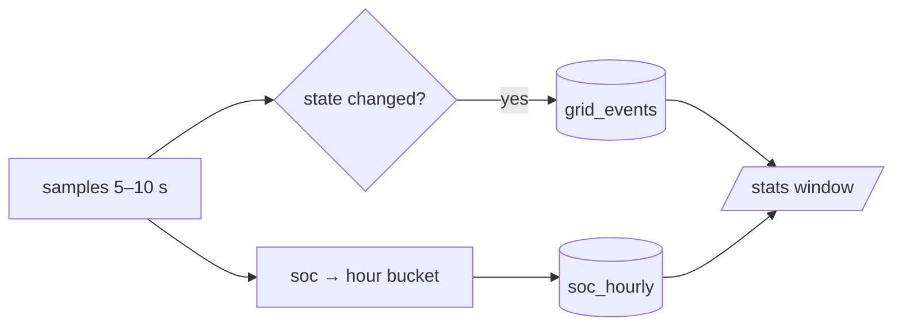

# Statistics, SOC and history import

## What is stored

| table | written by | content |
|---|---|---|
| `grid_events` | `Store.set_grid_state`, importer | one row per grid state change (`ts`, `powered`) |
| `soc_hourly` | `SignalEngine.observe`, importer | per hour: `min_soc`, `max_soc`, `sum_soc`, `count` |
| `meta` | poller/engine | `grid_powered`, `grid_since`, `last_seen` |

Only transitions are stored, never every sample: uptime, outage count, longest and
average outage are reconstructed from the transition list for any window. The SOC
rollup keeps hourly aggregates, so a year of history stays a few thousand rows.



## `/stats` windows

| input | window |
|---|---|
| `/stats` | last 24 h |
| `/stats day` / `7 days` / `3d` | 1 / 7 / 3 days |
| `/stats week` / `2 weeks` / `2w` | 1 / 2 weeks |
| `/stats 3m` / `6 months` | months (`m` = months, not minutes) |
| `/stats 2y` / `years` | years |

Ukrainian words work (`2 тижні`, `3 місяці`). Percentages are computed over the
*covered* interval, and when the database is younger than the requested window the
card adds `ℹ️ Дані з 01.11 13:48 · покриття 4хв` instead of pretending.

## Battery percentage

The inverter's own SOC register (229) drifts; the number the bot reports comes from
**pack voltage** through a piecewise-linear curve in `[battery]`:

```toml
[battery]
soc_source = "voltage"   # or "register" for the raw value
curve = [[22.40, 0], [24.00, 8], [25.90, 55], [26.10, 68], [26.70, 100]]  # abbreviated
```

The curve is anchored on a BMS reading (25.9 V ≈ 55 % for this 24 V LiFePO4 bank).
`soc` — the calibrated value — drives the bar, the alerts and the statistics; the raw
register value is shown next to it (`інв. 74%`) whenever they differ. Values are
interpolated linearly and clamped outside the table.

Voltage sags under load, so the estimate dips while the inverter pulls hard and
recovers at rest. It follows a BMS display far better than the drifting register, but
it is still an estimate between anchors.

## Importing a DessMonitor export

`tools/import_dessmonitor.py` backfills history from the `.xlsx` that the DessMonitor
portal exports
(no extra dependency: `zipfile` + regex).

```bash
.venv/bin/python tools/import_dessmonitor.py "I2000…(2026-10-17-2026-11-01).xlsx" --dry-run
.venv/bin/python tools/import_dessmonitor.py "I2000…xlsx"
```

- grid transitions come from the **Grid Voltage** column (> 100 V = on); with 5-minute
  sampling they are accurate to ±5 minutes;
- hourly SOC buckets are rebuilt from **Battery Voltage** through the same `[battery]`
  curve, so history and live samples stay one series;
- hours that already hold live samples are kept as they are (`INSERT OR IGNORE`),
  while gap hours the bot never saw are filled in; same-state event rows are
  compacted, so a second run inserts nothing (`inserted 0`);
- after the import, `grid_since` is moved back to the last imported transition, so
  `/status` shows the real outage length instead of the boot time.

`--shift-minutes` corrects the device clock. This inverter runs **1 hour ahead** of
local time; verify by comparing the newest row with the file's download time. Default
is `-60`.

The importer is safe to re-run and never deletes existing rows. It is the only writer
that touches the database from outside the service, so stop the service for large
imports if you want to avoid a `database is locked` retry.
